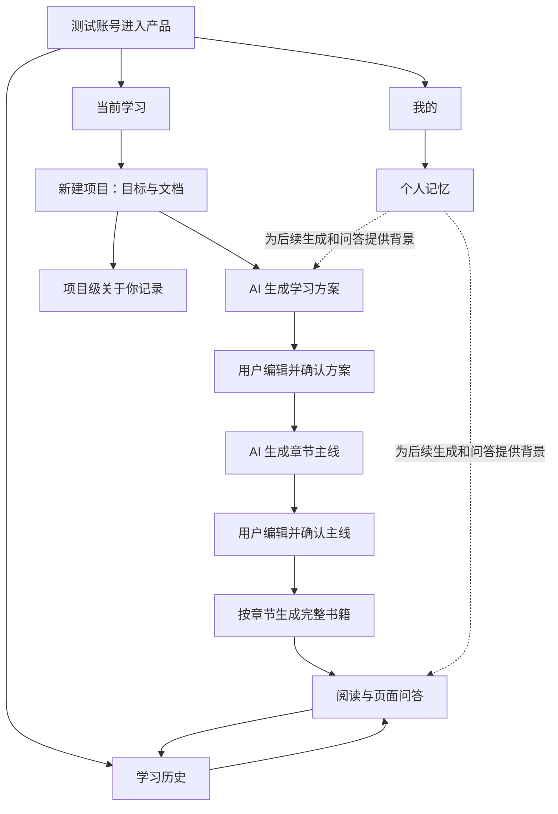

# 自学 AI 产品需求文档

版本：V2.1 已确认（含页面截图） · 更新日期：2026-10-18

**状态：2026-10-18 用户确认，进入第一条真实链路开发；尚未交付验收。** 本文描述目标产品，不代表当前原型已经连接真实 AI 或后台。产品范围以用户最新确认和 AI 书籍原型为依据，原有课程体系退出。原型中的固定示例、模拟生成时长和演示故障不作为正式产品规则。

## 1. 产品概述

### 1.1 背景与目标

用户希望从自己的材料和学习目标出发，生成完整学习书籍，在阅读中向 AI 提问，并保留学习过程与个人学习信息。产品以电脑浏览器使用为主，目前仅支持测试账号。

第一阶段先验证真实闭环：**填写目标、上传材料 → 确认学习方案 → 编辑并确认章节主线 → 生成一章完整内容 → 阅读与 AI 问答 → 保存并重新打开。** 最终交付范围仍是完整书籍，不缩减为单章或纯文本。

### 1.2 三个模块与产品构成

| 一级模块 | 用户任务 | 产品构成 |
| --- | --- | --- |
| 当前学习 | 创建、继续一个学习项目，阅读并解决疑问 | 项目列表、目标与材料、学习方案、章节主线、书籍生成、阅读器、页面问答、关于你 |
| 学习历史 | 按时间找回学习活动和对应项目 | 年份切换、月份分组、项目记录、返回学习 |
| 我的 | 查看账号、记录个人背景和偏好 | 测试账号信息、个人记忆列表、添加记忆 |

### 1.3 范围与实施约束

- 前端沿用已确认的原型设计，章节主线、书籍阅读与页面问答按最新 DeepTutor 参考交互实现。
- 后端与 AI 优先复用已核对的 **DeepTutor** 书籍能力，适配现有真实 AI、材料解析和数据库。DeepTutor 是复用项目名称，不代表指定 DeepSeek 模型供应商。
- 旧课程目录、旧课堂、旧课堂笔记、独立复习与自测、研讨室全部退出目标产品，不设置旧界面兼容要求。
- 书籍内部的测验、书页笔记、闪卡等属于新书籍内容，不等于保留旧课堂功能。
- 不复制整套 DeepTutor 管理后台、工作区、精通大纲、复习排程或精通会话；“关于你”仅复用学习者记录的产品形式。
- 不新增注册、多角色管理、分享发布、收费或团队协作功能。
- 下线旧功能不等于清空已有数据库；历史数据的展示处置见第 6 节。文档确认前不执行正式开发或数据删除。

### 1.4 文档中的事实与设计约定

**截图说明：**本文 12 张图于 2026-10-18 从本项目可交互原型截取，以桌面视口 1440×1100 展示页面或局部卡片，紧邻对应需求。截图用于说明布局与交互位置；模拟内容、残留旧文案与正式需求的差异已在图下注明。尚未实现的真实解析、完整内容块和后台异常不使用其他页面截图冒充。

页面及功能范围来自已确认原型与用户决策。后端数据模型、任务恢复和 AI 处理方式是本稿为真实实现提出的设计要求，尚未落地；物理表结构、接口路径、具体模型和资源限额在技术方案中落实。明确标为“待确认”的项不作为已批准功能。

## 2. 当前学习

### 2.1 用户任务与主流程

用户可以从列表继续项目，或使用学习目标和上传文档创建一本书。学习方案与章节主线分别由用户确认后才能推进下一阶段。阅读、问答与个人记录属于当前项目；不同项目的数据不能混用。

### 2.2 前端功能

#### CL-01 项目列表

*图 1 · 当前学习：项目列表。当前原型列表截图。卡片仍含“课已完成”等历史文案，正式实现按本节改为书籍章节与阅读进度，不恢复旧课堂。*

| 项目 | 要求 |
| --- | --- |
| 卡片内容 | 项目标题、学习目标摘要、生成/可阅读状态、阅读进度、最近学习时间 |
| 排序与数量 | 最近学习时间降序；新项目以创建时间参与排序。默认显示最多 6 个，超过 6 个可查看全部 |
| 新建入口 | 点击“新建学习项目”，打开第一步弹框 |
| 继续学习 | 按项目阶段进入方案、章节主线或阅读页；已阅读项目恢复上次章节 |
| 空状态 | 无项目时展示新建引导；查询失败时显示重试，不显示成无数据 |
| 进度含义 | 区分“生成了多少章”和“已读多少章”，不把生成完成视为学习完成 |

旧卡片中的“课已完成”调整为书籍章节口径。项目重命名、删除、搜索与筛选不因列表存在而默认增加。

#### CL-02 新建项目：目标与上传文档

*图 2 · 新建项目：目标与文档。第一步弹框。2026-10-18 补充确认：上传文档改为可选，截图中的旧必填规则不再适用。原型仅保存文件信息；正式上传、解析及失败状态按本节需求实现。*

| 字段或操作 | 规则 |
| --- | --- |
| 学习目标 | 必填，不能仅为空格；说明想学什么及希望达到的结果 |
| 上传文档 | 可选；未上传时根据学习目标生成通用知识内容，不伪造材料引用。上传时支持多选、拖放、查看列表和移除。目标格式为 PDF、Word、TXT、Markdown、PPT |
| 解析状态 | 每份文件区分上传中、解析中、可用、失败；失败说明原因并提供重试或移除 |
| 语言 | 默认自动，可选中文、English；自动跟随用户学习目标主要语言 |
| 内容深度 | 精简、标准、详尽，默认标准；影响解释和示例深度，不代表已有能力 |
| 生成方案 | 目标有效即可操作；如选择了材料，需等待所选材料解析成功；提交期间防重复点击 |
| 返回或取消 | 返回编辑时保留本次目标与材料；关闭弹框不自动生成书籍 |

如存在尚未解析成功的材料，不得悄悄忽略后生成：提示用户等待、重试或移除，随后再继续。文件大小、数量上限及扫描件支持范围见待确认项。

#### CL-03 学习方案

*图 3 · 确认学习方案。第二步弹框，展示可修改字段及确认主线入口。图中为模板示例，正式版本由真实 AI 生成；提示中的“课程”统一为书籍。*

AI 填充以下字段，用户可以修改：

| 字段 | 含义与规则 |
| --- | --- |
| 学习标题 | 项目/书籍名称，非空 |
| 学习描述 | 说明面向的学习需求和预期收获，非空 |
| 学习范围 | 要覆盖的主题及边界，非空 |
| 目标水平 | 学完希望达到的水平，非空；不能当作用户当前掌握情况 |
| 预计章节数 | 正整数；原型为 1–20，暂沿用为本稿范围，默认建议由方案生成结果给出 |
| 使用的材料 | 显示本次生成使用的文档，能够核对材料范围 |
| 编辑输入 / 上一步 | 返回目标与材料；输入改变后重新生成方案会替换未确认的旧方案，应先提示 |
| 确认方案并生成主线 | 保存用户最终修改版本，再请求章节主线生成 |

生成失败时保留输入，允许重试；保存失败时不能提示确认成功或进入下一步。

#### CL-04 章节主线

*图 4 · 检查章节主线。章节编辑卡片及固定底部操作区；下方其他章节可滚动查看。*

- 左侧显示项目标题、阶段和章节数；中间为章节编辑卡片；底部提供生成范围与“确认主线”。
- 每章包含：标题、内容类型、总结、学习目标（每行一项）。内容类型为理论、推导、历史、练习、概念。
- 支持修改、上移、下移、删除和新增。首章不能上移、末章不能下移；至少保留一章。重排后编号和阅读顺序一致。
- 确认前校验必填项；新增、删除后的实际章节数覆盖方案中的预计值。
- 2026-10-18 用户修订：确认主线后进入阅读页，不预先生成正文。点击未生成章节时只创建该章任务；已生成章节直接打开，重复点击复用已有任务。取消“生成全部章节”和“只生成第一章”选项。
- 主线编辑结果保存至服务端；生成使用已确认的版本。确认后的结构调整通过“重建书籍”进入，不在后台无提示改动目录。

#### CL-05 书籍生成与任务状态

*图 5 · 原型生成状态参考。2026-10-18 用户改为点击章节生成；图中的全书自动生成行为已不适用，当前章节状态与刷新恢复以后台真实任务为准。*

| 状态/操作 | 用户体验 |
| --- | --- |
| 排队、生成中 | 展示当前生成章节及完成数量；已有正文可以阅读 |
| 按章生成 | 点击未生成章节才排队生成；未点击的章节保持待生成 |
| 再次打开 | 已完成章节直接读取保存内容，不重新调用 AI；生成中的章节显示原任务进度 |
| 暂停、继续 | 暂停后保留已有结果；明确显示当前操作是否仍在结束中，继续时不重复成功部分 |
| 章节或内容块失败 | 标明失败范围和可理解原因；其他已完成内容仍可阅读 |
| 重试 | 重试失败章节/内容块，不无条件重建整本书 |
| 重新生成本章 | 提示受影响内容；成功后替换该章版本，失败时保留可用旧版本 |
| 断开或刷新 | 重新读取服务端任务状态；不能把断网误判为任务失败或重新发起相同任务 |

原型刷新后暂停是演示行为；正式产品以后台任务真实状态为准。模型超时、额度不足、解析失败分别反馈，不显示固定“额度已用完”占位文案。

#### CL-06 书籍阅读与完整内容

*图 6 · 书籍阅读。目录、正文图示及底部翻章。截图为勾股定理示例，不代表已经真实生成。*

- 左侧为本书导览和章节目录，显示生成状态；中间展示标题、学习目标和正文；底部支持上一章、下一章与阅读进度。
- 支持收起目录、收藏章节、恢复阅读位置、标记本章已读；长文、公式和图示保持可读。
- 阅读进度表示浏览或用户标记，不代表掌握程度。具体口径见 2.5。
- 未生成、生成中、部分失败和完成章节都有对应页面，不出现无法解释的空白页。
- 导出 Markdown 包含实际已生成内容，未完成部分注明状态；动态互动或视频采用资源链接/说明，不宣称 Markdown 能还原全部交互。
- 重建书籍须二次确认，说明将影响正文、阅读进度、书页笔记、作答与问答。先保留旧版本用于失败恢复，成功切换后新版本重新记录相关状态。

*图 7 · 同一阅读页下方的闪卡、测验和反馈。当前原型只演示部分内容块，其他类型尚无本产品实装截图，不用旧课堂或外部截图冒充。*

完整内容按已核对 DeepTutor 实际实现的 13 类内容块验收，按教学需要生成，不要求每章强行包含全部类型：

| 内容块 | 前端实现目标 |
| --- | --- |
| text 正文 | 正文与公式显示 |
| section 章节段落 | 标题、段落及层级结构 |
| callout 提示 | 重点、解释、提醒的语义区分 |
| quiz 测验 | 作答、提交、反馈、记录恢复 |
| user_note 书页笔记 | 编辑、保存与重新打开 |
| figure 图表 | 本次接入可缩放 SVG 图示，表达图表、流程和几何关系；已有章节可单独添加，失败重试不重写正文 |
| interactive 交互内容 | 在隔离区域操作可视化内容 |
| animation 动画 | 2026-10-18 用户确认采用网页动画，支持播放、暂停、重播；已有章节可单独添加；不再要求本地 Manim 视频渲染。失败不能用静态图冒充完成 |
| code 代码 | 代码和解释的格式化展示，不默认提供任意代码执行 |
| timeline 时间轴 | 有顺序的事件与说明 |
| flash_cards 闪卡 | 翻面查看问题与答案 |
| deep_dive 深入讲解 | 发起深入讲解、展示结果并返回原章节 |
| concept_graph 概念图 | 展示概念关系及相关章节跳转 |

本次实装截图（2026-10-18，独立测试书真实 AI 生成）：

截图只能呈现动画的一帧；浏览器已验证播放推进、暂停保持和重播回到第一步。

#### CL-07 页面 AI 问答

*图 8 · 阅读中的页面问答。右侧显示当前章节上下文和对话；图中回答为预设示例，正式版本按本节接入真实问答。*

- 点击“聊天”打开右侧页面问答栏，可关闭；显示当前章节上下文。
- 非空问题可发送；展示回答生成状态、正文及失败重试。用户消息先保存，再生成回复。
- 会话按用户、项目、书籍版本和章节隔离；切换章节后显示该章会话，不串用旧章回答。
- 上下文使用当前章节内容、相关材料和适用的个人记忆。依据上传材料回答时提供可定位出处；补充通用知识时说明不是材料原文。
- 依据不足时明确说明，不编造材料中的结论或引用。提问不直接修改书籍正文。
- 附件提问、联网搜索、自动执行任务不纳入本版页面问答范围。

#### CL-08 关于你

*图 9 · 关于你。从新书页截取的完整卡片；未采集的基础显示“尚未记录”。*

参照 DeepTutor 精通之路的只读学习者卡片；在项目相关页面展示，不复制整个精通之路模块。

| 信息 | 来源及规则 |
| --- | --- |
| 想学习 | 当前项目标题/主题 |
| 已经会的 | 用户明确提供的已有知识；未采集时显示“尚未记录”，不得从已读进度推断 |
| 想达到 | 用户填写的学习目标；与方案的目标水平分别保存 |
| 可用时间、教学偏好、其他 | 仅有明确记录时展示；当前没有新增必填采集表单 |

第一阶段只展示已确定的项目主题与目标；不把 AI 方案推断当作用户事实。是否从会话自动提取、纠正并更新已有基础等信息，列为待确认扩展。

### 2.3 后端功能

| 能力 | 后端实现目标 |
| --- | --- |
| 项目服务 | 创建、查询项目，记录阶段、所有者与书籍关联，提供继续学习位置 |
| 材料服务 | 文件接收与存储、格式检查、解析任务、解析结果保存、与项目绑定 |
| 方案与主线服务 | 接收生成请求、校验结构化结果、保存用户修改和确认版本 |
| 生成任务服务 | 章节排队、状态查询与进度通知、暂停继续、失败重试、重复请求合并 |
| 书籍内容服务 | 管理章节、内容块及资源；按版本查询、导出、重建和替换 |
| 阅读服务 | 保存位置、进度、收藏、书页笔记、测验作答与反馈 |
| 会话服务 | 保存消息与生成状态，组织上下文，隔离项目与章节，支持失败重试 |
| 学习者记录服务 | 提供项目级目标与已知背景，记录来源及更新时间，未知信息保持为空 |

长任务不能依赖一个浏览器请求持续存活。服务重启后必须能识别已完成结果和中断任务，提供可恢复或可重试状态；具体进程部署与事件传输协议在技术方案中确定。

### 2.4 数据库与文件存储

现有应用使用 SQLite。以下为**逻辑数据模型**，不是已创建的表结构；可扩展现有模型，不能直接沿用旧课节对象替代书籍内容块。

| 数据对象 | 关键字段 | 关系与保存时机 |
| --- | --- | --- |
| 学习项目 | 项目 ID、用户 ID、标题、学习目标、阶段、书籍 ID、创建/更新时间、最近学习时间 | 用户有多个项目；首次提交有效输入时创建 |
| 材料 | 材料 ID、项目 ID、文件名、格式、大小、文件引用、解析状态、错误信息、内容版本 | 项目有多份材料；上传与解析状态分别更新 |
| 材料片段 | 片段 ID、材料 ID、正文、页码/段落定位、索引引用 | 为生成和引用提供依据；是否建立向量索引按检索方案确定 |
| 学习方案 | 项目 ID、方案版本、标题、描述、范围、目标水平、预计章节数、语言、深度、来源版本、确认状态 | 保存 AI 结果和用户最终修改；主线关联确认版本 |
| 书籍与主线 | 书籍 ID、项目 ID、版本、章节 ID、顺序、标题、类型、总结、目标、确认状态 | 一项目对应当前书籍，重建形成新版本 |
| 章节与内容块 | 章节 ID、块 ID、块类型、顺序、内容/资源引用、生成状态、版本、错误信息 | 支持部分成功、块级重试和版本替换 |
| 生成任务 | 任务 ID、作用对象、输入版本、状态、进度、去重标识、时间、错误、重试关联 | 每次提交先记录任务；重连查询同一任务 |
| 阅读状态 | 用户 ID、书籍版本、章节 ID、阅读位置、最大进度、已读标记、收藏、更新时间 | 阅读过程中保存，重开恢复；与生成状态独立 |
| 书页笔记与作答 | 用户 ID、章节/块 ID、内容版本、笔记/答案、提交状态、反馈、时间 | 显式提交或保存成功后更新；不复用旧课堂题目记录 |
| 会话与消息 | 会话 ID、用户/项目/书籍版本/章节 ID、角色、文本、引用、状态、请求关联、时间 | 按章恢复对话；重试不重复用户消息 |
| 项目学习者记录 | 项目 ID、已有基础、目标、时间、偏好、备注、信息来源、更新时间 | 目标复用项目记录；其他仅保存明确输入 |

**存储分工（本稿建议）：**现有 SQLite 管理用户、项目索引、书籍映射、学习活动与个人记忆；复用 DeepTutor 的书籍服务管理书籍版本、主线、正文、内容块及资源。书籍相关任务和会话的唯一写入方在接口设计时落实，通过服务接口读写，不直接绕过引擎修改文件。数据库只保存必要关联或查询索引，避免正文和任务状态出现两份相互覆盖的权威数据。

上传原文件、解析产物、图片与动画分别保存为文件资源，数据库/书籍清单保存引用。文件与业务数据的备份、重建切换须保持一致。表名、字段类型、索引及迁移脚本属于技术方案，不在本稿宣称已确定。

### 2.5 业务规则与异常处理

1. 方案、主线和正文逐级使用确认版本；上游修改后不得默默用旧输入继续生成。
2. 上传与解析是两个状态；文件名称出现不等于解析成功。
3. 本稿建议阅读进度按章节滚动最大位置保存；“已读”由阅读到底或显式标记产生，往回滚动不降低进度。项目进度为已读章节数/可计入目录的正文总章节数，本书导览不计入；不是 AI 掌握度评价。
4. 生成成功、打开目录和创建项目不能自动记为已读。单章重生成或重建改变内容版本时，相关阅读/作答状态不直接继承为完成。
5. 生成失败保留可用输入和成功内容；再次执行只处理指定失败范围。相同请求重复提交不能多建项目、多计活动或重复占用任务。
6. 权限、存储或模型调用失败必须反馈；数据库写入失败时不能显示保存成功。
7. 真实模型输出必须经过结构与内容检查后进入可用状态，不能因请求返回成功就认为章节可阅读。
8. 文件数量、大小、生成并发和最长等待时间使用可配置限制，具体值待验证后填写，不虚构性能承诺。

### 2.6 AI 能力、技术与实现目标

以下为拟实现方式，优先适配 DeepTutor 已有能力。模型名称、服务部署与参数由技术验证确定；不要求额外训练模型。

| AI 能力 | 输入 | 涉及技术与处理 | 输出与实现目标 |
| --- | --- | --- | --- |
| 材料理解 | 用户文档、解析结果 | 文档结构提取、文本分段、保留页码/段落位置；扫描件如纳入则增加 OCR | 产生可追溯材料正文，避免仅用文件名生成内容 |
| 学习方案 | 学习目标、材料内容、语言、深度、适用的个人记忆 | 大语言模型、提示词组织、结构化输出及字段校验 | 生成与目标匹配、覆盖材料边界的可编辑方案 |
| 章节规划 | 用户确认方案与材料范围 | 分阶段规划、结构化输出、章节重复和覆盖检查 | 生成有合理顺序、目标与总结的主线，不覆盖用户手动确认结果 |
| 完整内容生成 | 已确认主线、材料、相关章节上下文 | 章节级编排、内容块生成器、Markdown/公式、图表与可视化生成、结果校验 | 有完整讲解而非仅标题或摘要；不同内容类型形成对应教学表达 |
| 图示、交互与动画 | 概念、说明、可视化要求 | 图表/SVG/Mermaid、隔离 HTML 交互；动画生成流水线及其运行依赖 | 资源真实可展示或操作；动画实际可播放，失败范围明确 |
| 测验与反馈 | 本章知识、题目、用户作答 | 结构化出题与答案校验；客观题规则判定，需语义理解的作答使用模型评价 | 给出对应题目的解析与反馈；不能用固定回复冒充评价 |
| 页面问答 | 问题、当前章、会话、相关材料 | 章节上下文组织、检索增强生成（RAG）、引用绑定、会话长度管理 | 基于当前内容解答；保留上下文，依据不足时说明 |
| 深入讲解 | 选定知识点及本章上下文 | 按需生成、结果保存、子内容关联 | 提供更深入的解释，用户能返回原阅读位置 |
| 个性化表达 | 用户明确提供的背景和偏好 | 相关记忆筛选、上下文注入、输入快照 | 调整解释深度、例子与表达；不更改材料事实 |
| 关于你自动更新（待确认） | 用户在会话中的明确自述或纠正 | 结构化信息抽取、来源记录、冲突处理 | 如果纳入，记录可纠正的事实；不能从读完章节推断掌握 |

**AI 验收重点：**目标与材料相关性、章节覆盖与顺序、正文完整性、公式和事实正确性、引用可追溯、内容块可用、问答相关性及依据不足时的处理。用固定材料和问题做重复验证，不只验收“接口能返回文字”。涉及动画等能力时需独立验证真实依赖，不能因源码存在就标记可用。

### 2.7 当前学习验收标准

| 编号 | 验收场景 | 通过条件 |
| --- | --- | --- |
| CL-A01 | 从上传到章节主线 | 真实材料解析成功；方案和主线可编辑，确认结果与生成输入一致 |
| CL-A02 | 一章完整内容 | 对应上传材料与目标，有连贯正文及该章需要的内容块；非固定示例 |
| CL-A03 | 页面问答 | 能围绕当前章回答、展示依据；切换章不串会话，重新打开保留记录 |
| CL-A04 | 状态恢复 | 刷新、断开重连后恢复任务真实状态、阅读位置和已保存内容 |
| CL-A05 | 异常重试 | 解析/生成/保存失败有反馈；重试不重复成功内容或业务记录 |
| CL-A06 | 全书能力 | 全部章节可完成生成；13 类内容块分别通过适用场景验证 |
| CL-A07 | 导出与重建 | 导出对应当前版本；重建有确认和影响说明，失败不丢可用旧版本 |
| CL-A08 | 关于你 | 正确显示本项目目标；未知字段不编造、不把阅读进度当掌握度 |

## 3. 学习历史

### 3.1 前端功能

*图 10 · 学习历史。年份切换、按月分组和项目入口。旧项目仅为当前原型样例，其正式处置仍按第 6 节待确认规则处理。*

| 功能 | 要求 |
| --- | --- |
| 年份切换 | 当前年及有学习记录的年份可选择 |
| 按月查看 | 依据活动时间按月份分组，最近月份优先 |
| 项目记录 | 展示项目名称、最近活动时间和当前阅读进度；同一月相同项目合并展示 |
| 返回项目 | 点击新书项目进入阅读页，恢复对应项目最近阅读章节 |
| 空状态与错误 | 无活动显示空状态，查询失败提供重试，不混为同一种状态 |

页面结构保持现有形式，不增加 AI 学习总结、能力评分或推荐。

### 3.2 后端功能与数据库

后端记录真实学习事件，提供按用户、年份、月份查询与项目聚合结果。时间保存为可统一比较的时间戳，界面按约定本地时区分组。

| 数据对象 | 关键字段 | 保存与关联 |
| --- | --- | --- |
| 学习事件 | 事件 ID、用户 ID、项目/书籍/章节 ID、类型、发生时间、去重标识 | 有效阅读、发送问题、提交测验、标记已读等实际行为产生事件 |
| 历史查询结果 | 年份、月份、项目标题、最近活动时间、当前阅读进度 | 由事件和当前项目数据查询得到，不另建第二份完成进度 |

事件类型作为本稿建议：有效进入可阅读章节、提交问答问题、提交书内测验、标记已读。滚动位置频繁更新不逐次生成历史行。生成完成、打开项目列表、预览主线不记为学习。

同一月的同一项目展示一条聚合记录，底层保留真实事件。项目最近学习时间来源于学习事件；旧数据处置见第 6 节，不为保留旧历史恢复旧课堂入口。

### 3.3 AI 技术与实现目标

本模块不需要独立 AI 调用。事件记录、排序、分组和进度查询由普通后端完成。不得使用 AI 推测不存在的活动、学习时长或掌握度。

### 3.4 验收标准

- 年份和月份正确，跨年记录能够查到。
- 完成书籍生成但未阅读时，不出现虚构的学习记录。
- 同月多次学习同一项目，列表聚合正确，最近时间更新。
- 点击记录进入正确项目；不同项目进度不混用。
- 刷新后记录保持；查询异常有明确反馈。

## 4. 我的

### 4.1 前端功能

*图 11 · 我的与个人记忆。测试账号及个人记忆列表。截图中的“课程”历史文案在正式版本统一调整为书籍。*

| 功能 | 要求 |
| --- | --- |
| 账号信息 | 展示当前测试账号，不新增注册和账号管理页面 |
| 个人记忆列表 | 展示用户主动提供的背景、熟悉领域和解释偏好 |
| 添加记忆 | 文本非空，最多 2000 字；保存成功后进入列表 |
| 保存反馈 | 保存失败保留输入，不显示成功；用户可重试或取消 |
| 空状态 | 无记忆时提示可添加背景或偏好 |

*图 12 · 添加记忆表单及保存/取消操作。*

记忆编辑、删除与自动整理未在当前原型确认，不默认扩展。未知账号资料不虚构。

### 4.2 后端功能与数据库

| 数据对象 | 关键字段 | 保存与关联 |
| --- | --- | --- |
| 用户/测试账号 | 用户 ID、显示信息、身份关联 | 所有项目、历史、记忆归属于当前账号；沿用现有身份接入 |
| 个人记忆 | 记忆 ID、用户 ID、内容、来源、创建/更新时间 | 来源首期为用户手动输入；服务端保存成功后前端更新 |
| 记忆使用快照/引用 | 生成任务或消息 ID、使用的记忆 ID/版本 | 记录生成所用背景，便于解释结果和排查后续变化 |

个人记忆属于用户，可用于多个项目；“关于你”属于当前项目，主要记录本项目学习目标与已有基础。两者不能混为同一份数据，也不能把某一本书的目标自动传播到所有项目。

### 4.3 AI 技术与实现目标

- 保存和展示个人记忆本身不调用 AI。
- 生成或问答时，筛选与当前任务相关的用户记忆，作为背景加入模型上下文；初期可使用明确规则与文本匹配，是否需要模型或向量检索由实际数据量决定。
- 实现目标是改善讲解方式与案例贴合度，不让个人偏好改变事实、来源结论或作答记录。
- 新增记忆仅影响后续请求，不自动重写已生成书籍。需要应用到旧内容时，通过用户明确触发的重新生成操作完成。
- 不默认增加自动提取、自动删除或纠正个人记忆的 AI agent。若纳入，必须先明确用户可见的来源与纠正方式。

### 4.4 验收标准

- 记忆添加成功后刷新仍存在，失败时内容不丢失。
- 空白和超过长度限制的输入不能提交。
- 数据归属于正确账号，不显示其他账号记忆。
- 生成和问答只使用相关记忆，新增记忆不无提示改变旧书籍。
- 项目“关于你”和用户个人记忆的作用范围正确。

## 5. 公共要求与交付验收

### 5.1 非功能要求

- **可靠性：**生成任务、正文与用户输入可恢复；模型失败不能导致已保存学习数据丢失。
- **安全：**上传材料按用户与项目隔离；凭据不暴露给前端；模型生成 HTML/交互使用隔离环境，不直接注入主页面执行。
- **一致性：**进度、正文版本、会话和文件引用保持关联；重复请求、重连和重试不能创建互相冲突的状态。
- **体验：**电脑浏览器为主，保持原型布局和中文文案；长任务有进度与可理解反馈，字段与按钮支持键盘操作。
- **可排查性：**按任务记录失败阶段、错误类型及使用的内容版本，不将用户文档全文或凭据随意写入日志。
- **性能：**文件上限、并发、等待时间及资源成本上限尚未确定，验证后写入技术方案，不使用模拟生成耗时作为承诺。

### 5.2 分阶段交付

| 阶段 | 交付内容 | 验收边界 |
| --- | --- | --- |
| 需求审阅 | 本文、待确认项和对应原型 | 用户确认后才能开始正式实现 |
| 第一条真实链路 | 目标与上传、方案、主线、一章完整内容、页面问答、保存恢复 | 不允许用固定示例冒充真实生成；完成 CL-A01 至 CL-A05 的相关场景 |
| 全书与完整内容 | 全部章节、13 类内容块、生成控制、导出重建 | 逐类验证实际输出，不要求第一条链路一次覆盖所有内容块 |
| 产品整合 | 三个模块、关于你、个人记忆、旧功能退出 | 数据连通、入口一致，检查正常与异常路径 |

Codex 负责实现、联调和交付前测试，提交可运行版本与已知限制；用户负责需求审阅、最终验收及后续安排。阶段通过不等于全部产品已完成。

### 5.3 固定验收样本

开发前准备可使用的文字材料、含结构或公式的材料及对应问题。第一阶段至少用一份实际材料验证方案、章节与回答相关性；后续按内容块补充适用样本。AI 效果同时检查材料依据和呈现结果，不仅检查请求状态码。具体样本及可接受结果在联调记录中保存。

## 6. 待确认事项与风险

| 项目 | 本稿处理方式 | 为什么需要明确 |
| --- | --- | --- |
| 旧数据展示 | 不恢复旧课堂、不删除原数据库。建议旧学习记录仅保留为只读历史摘要，不能进入旧课堂；最终展示方式待确认 | “旧功能全部删除”与“历史不动”需要在数据层明确界线 |
| 关于你自动更新 | 第一阶段仅展示已填写主题与目标，未知基础为空；自动从会话抽取暂不开发 | 原型没有纠正、审核和冲突处理流程 |
| 文件支持与限制 | 目标格式按原型；具体解析器可用性、文件大小/数量上限、扫描件 OCR 范围待技术验证 | 不能把可选择文件误认为已支持解析全部格式 |
| 生成与阅读进度 | 本稿建议采用 2.5 和 3.2 的口径，待审阅确认 | 原型进度为演示，正式历史需要统一定义 |
| 模型、服务与存储 | 保留现有基础，优先复用 DeepTutor；具体部署、模型适配、任务与会话唯一写入方在技术方案落实 | 源码版本可核对，不等于集成已可运行 |
| 动画与交互依赖 | 属于完整书籍目标；前期核对发现用户确认使用隔离网页动画替代 Manim 视频，需独立验证动态效果与播放控制 | 不用静态占位替代完整能力，依赖与资源成本影响交付 |

以上未决项不自动扩展产品范围。开发中遇到影响范围、数据处置或交付目标的变更，与用户确认后更新本文。

## 7. 来源与关联文档

本稿参考 `templates/prd.md`，按用户要求改为三个模块各自包含前端、后端/数据库、AI 和验收的结构。

| 来源 | 用途与优先级 |
| --- | --- |
| 用户最新确认：三个模块、旧功能全部退出、完整书籍、分工与首条链路 | 最高优先级的产品决策 |
| [协作分工与进度](./协作分工与进度.md) | 工作顺序、责任与当前实施状态 |
| [原型主规格](../../prototypes/ai-learning/.spec/spec.html)与当前原型 | 已有页面与交互依据；其中旧课程记录不再作为目标范围 |
| [DeepTutor 完整书籍迁移核对](./DeepTutor完整书籍迁移核对.md) | 已核对的内容块能力、依赖与源码事实；文中旧界面保留建议已被最新决策替代 |
| [技术方案](./技术方案.md) | 前期复用研究；确认本稿后同步更新实施方案 |
| [旧需求历史参考](./产品需求历史参考-原课程与原型迭代.md) | 仅供追溯，不作为本轮验收依据 |

本轮仅重写需求文档并同步状态，不修改真实应用、模型配置、数据库或原型行为。
